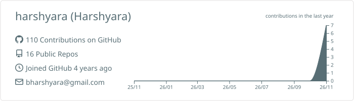
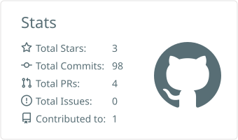
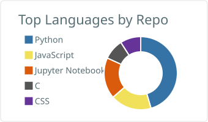

**Information Security Engineer @ PhonePe** · Bangalore, India

I build security infrastructure for one of India's largest payments platforms

---

### 🛡️ What I work on

- 🧱 **Web Application Firewall:** a reverse-proxy WAF in **Rust** on the **Coraza** engine that inspects production HTTP traffic in-line and blocks OWASP Top 10 attacks (SQLi, XSS, RCE) before they reach upstream services
- 📡 **Detection engineering:** SIEM log pipelines into production **ELK**, with **ClickHouse** and **Redis** behind them for low-latency correlation of security telemetry
- 🌐 **Edge security:** bot management, rate limits, geo-fencing and DDoS mitigation on **Cloudflare** and **Akamai**
- 🤖 **SOC automation:** an L1 triage Slack bot in **Go** that auto-triages alerts and enriches IOCs

---

### 🎒 Inventory

**Languages**

**Application security**

**Edge, WAF & proxies**

**Detection & vulnerability management**

**Cloud & infrastructure**

**Databases**

---

### 🗺️ Experience

| | Role | Where | When |
|:-:|---|---|---|
| 🟢 | **Information Security Engineer** | PhonePe · Bangalore | May 2025 – Present |
| 🩷 | **Information Security Intern** | PhonePe · Bangalore | Nov 2024 – Apr 2025 |
| 🎓 | **B.Tech, Computer Science & Engineering** (GPA 9.45/10) | Dayananda Sagar University | 2021 – 2025 |

---
 
### 📊 Stats
 

&nbsp;
 

---

### 🌸 Off the clock

📚 Reading · ♟️ Chess · 🏸 Badminton · 🎧 Music · ✏️ Sketching · 🎬 Documentaries · 💬 Comics · 🦉 Learning languages on Duolingo

Read my notes at <a href="https://harshyara.blog">harshyara.blog</a> ♥

